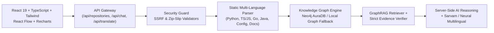

# CodeSage AI — Evidence-Based Codebase Intelligence Platform

**hackFront India 2026 | Theme T1: AI and Developer Tools | Problem Statement T1.1: “Why The Code Is Like This”**  
**Team:** INNOVATION NINJAS

CodeSage AI is an evidence-first developer intelligence platform that explains **why** a software repository is architected the way it is. Every AI explanation is grounded in statically extracted AST symbols, Knowledge Graph relationships, Architectural Decision Records (ADRs), and verbatim source-code line citations so engineers can verify claims in seconds.

---

## Key Capabilities

1. **Verifiable GraphRAG Q&A (`Ask CodeSage`)**: Hybrid lexical + Knowledge Graph 2-hop retrieval paired with a server-side **Strict Evidence Verifier** that validates every cited file path and line range against the indexed repository—preventing fabricated filenames or line numbers.
2. **Interactive Repository Knowledge Graph (`@xyflow/react`)**: Explores `Repository`, `File`, `Function`, `Class`, `APIEndpoint`, `Configuration`, `Test`, and `Documentation` nodes across `CONTAINS`, `IMPORTS`, `CALLS`, `DEPENDS_ON`, `CONFIGURES`, `TESTS`, and `DOCUMENTS` edges, distinguishing **Observed AST** edges from **Inferred** cross-module relationships.
3. **Dependencies & Blast-Radius Simulator**: Answers *"What could break if this file changes?"* by traversing reverse import chains, affected HTTP endpoints, and covering test suites, alongside a BFS Shortest Dependency Path Finder.
4. **Live Public GitHub & Safe `.ZIP` Ingestion**: Index public HTTPS GitHub repositories or uploaded `.zip` archives with strict SSRF host allowlisting, zip-slip path normalization, binary/lockfile filtering, and non-executing read-only AST parsing.
5. **Indian-Language Explanations**: Supports English, Tamil (தமிழ்), Hindi (हिन्दी), Telugu (తెలుగు), Malayalam (മലയാളം), Kannada (ಕನ್ನಡ), and Bengali (বাংলা) via Sarvam AI when configured, with automatic neural fallback that preserves ASCII code identifiers, file paths, and citation anchors.
6. **Honest Integration Telemetry**: `GET /api/health` reports real service states (`Connected`, `Local Graph Fallback`, `Not Configured · AI Fallback`)—never misrepresenting unconfigured databases or external APIs.

---

## System Architecture



---

## Project Structure

- `src/` — React + TypeScript frontend (`pages/`, `components/chat/`, `components/graph/`, `components/evidence/`, `components/modals/`, `layouts/`, `context/`, `services/`, `types/`)
- `server.ts` & `server/` — Full-stack runtime server (`security.ts`, `parser.ts`, `graphEngine.ts`, `ingestor.ts`, `ragEngine.ts`, `sampleRepos.ts`)
- `backend/` — Modular Python FastAPI implementation (`app/main.py`, `app/core/`, `app/security/`, `app/parsers/`, `app/graph/`, `tests/`)
- `tests/verify_engine.ts` — Automated end-to-end verification suite

---

## Local Setup & Commands

### 1. Full-Stack Web Workspace (Node.js + Vite + Express on Port 3000)

```bash
npm install
cp .env.example .env
npm run dev
```

Run static typecheck, engine verification tests, and production build:

```bash
npm run lint
npx tsx tests/verify_engine.ts
npm run build
```

### 2. Windows PowerShell Setup & Run Instructions

```powershell
# Clone and enter workspace
npm install

# Copy environment template
Copy-Item .env.example .env

# Start dev server (Express + Vite on http://localhost:3000)
npm run dev

# Run automated engine verification tests
npx tsx tests/verify_engine.ts

# Production build check
npm run build
```

### 3. Standalone Python FastAPI Service (Optional Reference Server on Port 8000)

```bash
cd backend
pip install -r requirements.txt
pytest
uvicorn app.main:app --reload --port 8000
```

---

## Complete Backend REST API Reference

| Method | Endpoint | Description |
| :--- | :--- | :--- |
| `GET` | `/api/health` | Live service telemetry for Neo4j, Sarvam, and Gemini GraphRAG |
| `GET` | `/api/repositories` | List indexed and sample repositories |
| `POST` | `/api/repositories` | Validate and index public GitHub repository URL |
| `POST` | `/api/repositories/upload` | Upload and unpack `.zip` archive for AST parsing |
| `POST` | `/api/repositories/index` | Trigger re-indexing of an existing repository |
| `DELETE`| `/api/repositories/:id` | Remove repository and clear cached AST data |
| `GET` | `/api/repositories/:id/status` | Current indexing progress, stage, and message |
| `GET` | `/api/repositories/:id/files` | Discovered source files, lines, and extracted symbols |
| `GET` | `/api/repositories/:id/files/content` | Verbatim source file content and line slice |
| `GET` | `/api/repositories/:id/graph` | Knowledge Graph nodes and edges (Observed vs Inferred) |
| `GET` | `/api/repositories/:id/dependencies` | Blast-radius and shortest dependency path |
| `GET` | `/api/repositories/:id/analysis` | Code metrics, layers, high-coupling hubs, and findings |
| `POST` | `/api/chat` | GraphRAG Q&A with Strict Evidence Verifier |
| `GET` | `/api/evidence/:id` | Retrieve verified evidence snippet by citation ID |
| `POST` | `/api/translate` | Multilingual translation preserving code identifiers |
| `POST` | `/api/impact/analyze` | Dedicated change impact & blast-radius simulation |
| `POST` | `/api/investigations/export` | Download investigation report (Markdown / JSON) |

---

## 7 Interactive Code Investigation Tools

1. **Architecture Detective:** Identifies layers, entry points, public interface boundaries, and high-coupling hubs.
2. **Bug Investigation:** Form to describe errors / paste stack traces, mapping them to suspect AST locations with clear distinction between verified findings and hypotheses.
3. **API Flow Tracer:** Step-by-step trace of HTTP routes through auth middleware, domain logic, and persistence.
4. **Code Change Planner:** Evidence-backed checklist of upstream callers to re-test and covering unit tests.
5. **Documentation Generator:** Auto-generates Markdown architecture & module references with one-click copy and download.
6. **Repository Health Audit:** Evaluates oversized files, untested modules, and circular/high-coupling risks.
7. **Export Investigation:** Packages question history, blast radius findings, and evidence citations into downloadable Markdown or JSON reports.

---

## Hackathon Demonstration Scenario (10-Step Walkthrough)

1. **Open CodeSage AI** at `/` to view the Welcome dashboard, active repository status, Knowledge Graph preview, and Verified Source Evidence panel.
2. **Import or Select a Repository**: Click **Import Repo** in the top navigation bar to index a live public GitHub repository (e.g. `https://github.com/expressjs/cors` or `https://github.com/pallets/itsdangerous`) or inspect the pre-indexed `innovation-ninjas/fintech-auth-platform` (clearly labelled *Sample*).
3. **Verify Discovered Files**: Open **Repository Explorer** (`/explorer`) to browse extracted files, AST symbols, and line counts.
4. **Ask an Architectural Question**: Navigate to **Ask CodeSage** (`/ask`) and ask: *"Why does this project use JWT authentication instead of session-based authentication?"*
5. **Inspect Grounded Reasoning**: Review the structured explanation sections, confidence estimate, and verification scope disclosure.
6. **Verify Source Citations**: Click `[2] jwt_handler.py:L8–L51` or **Open** in the Evidence panel to jump directly to the highlighted lines in Repository Explorer.
7. **Explore Knowledge Graph**: Open **Knowledge Graph** (`/graph`), click `jwt_handler.py` or `POST /login`, inspect incoming/outgoing edges, and preview the parameterized Neo4j Cypher queries.
8. **Simulate Blast Radius**: Open **Dependencies** (`/dependencies`), select `backend/app/auth/jwt_handler.py`, and inspect direct/transitive dependents, affected API endpoints, and `test_auth_jwt.py` coverage.
9. **Switch Explanation Language to Tamil**: Click **தமிழ்** in the conversation card's Translate bar to read the architectural explanation in Tamil while all file paths (`backend/app/auth/jwt_handler.py`) and symbol identifiers remain intact.
10. **Audit Service Honesty**: Open **Settings / Diagnostics** (`/settings`) to verify live `/api/health` telemetry for Neo4j, Sarvam, and GraphRAG engines.

---

## Known Limitations

- Static parser extracts functions, classes, imports, exports, and statically identifiable calls without executing code; dynamic reflection or runtime dependency injection is marked as `inferred` or omitted.
- Public GitHub unauthenticated tree ingestion is capped at 65 source files (200 KB max per file) to ensure fast indexing and respect GitHub rate limits; configure `GITHUB_TOKEN` for higher rate limits.
